# Informe de vulnerabilidades – Cafetería Origen (TP4)

---

## 1. Fichas

#### VUL-01

**Inyección SQL en el login**

- **Dónde está:** `src/services/usuarios.service.ts` (consulta de autenticación).
- **Por qué ocurre:** usuario y contraseña se concatenan dentro del texto SQL; el `'` del atacante cierra la cadena y el resto pasa a ser SQL.
- **Cómo se observó:** en el login del panel, ingresando `' OR 1=1 --` como usuario y cualquier contraseña, se inicia sesión como administrador sin conocer la clave.
- **Cómo se corrigió:** se parametrizó la consulta con `$1` para buscar por `username` y se validó la contraseña mediante `bcrypt.compare()`.
- **Captura:** 
- **Reflexión:** toda consulta debería usar parámetros por defecto, y la revisión de código debería rechazar cualquier SQL armado con concatenación de texto del usuario.

---

#### VUL-02

**Inyección SQL en los filtros del catálogo**

- **Dónde está:** `src/services/catalogo.service.ts` (función `listar`).
- **Por qué ocurre:** los filtros `tipo`, `variedad` y la búsqueda `q` se concatenan directamente en la cláusula `WHERE`.
- **Cómo se observó:** en el buscador del menú escribimos `' OR 1=1) --`. La web devolvió los **20 productos** del catálogo en lugar de los que coinciden con el texto.
- **Cómo se corrigió:** se armó la consulta utilizando marcadores posicionales (`$1`, `$2`, …) y un arreglo separado de parámetros.
- **Captura:** 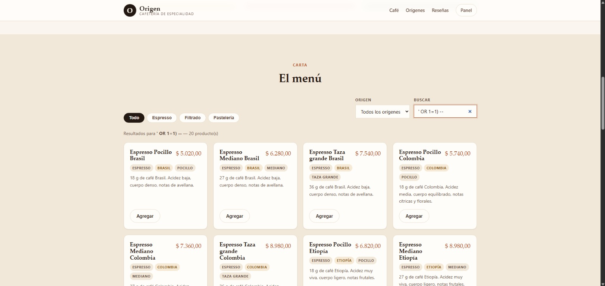
- **Reflexión:** parametrizar siempre las consultas y validar el tipo y valores permitidos de cada filtro en el borde de la API.

---

#### VUL-03

**Inyección SQL en el filtro por mesa**

- **Dónde está:** `src/services/pedidos.service.ts` (función `listar`).
- **Por qué ocurre:** `WHERE mesa = '${mesa}'` concatena el parámetro recibido por query string.
- **Cómo se observó:** desde Postman, `GET /api/pedidos?mesa=' OR '1'='1` respondió `200 OK` con los pedidos de **todas** las mesas (incluyendo cliente, estado y total).
- **Cómo se corrigió:** se reemplazó la interpolación por una consulta parametrizada (`WHERE mesa = $1`).
- **Captura:** 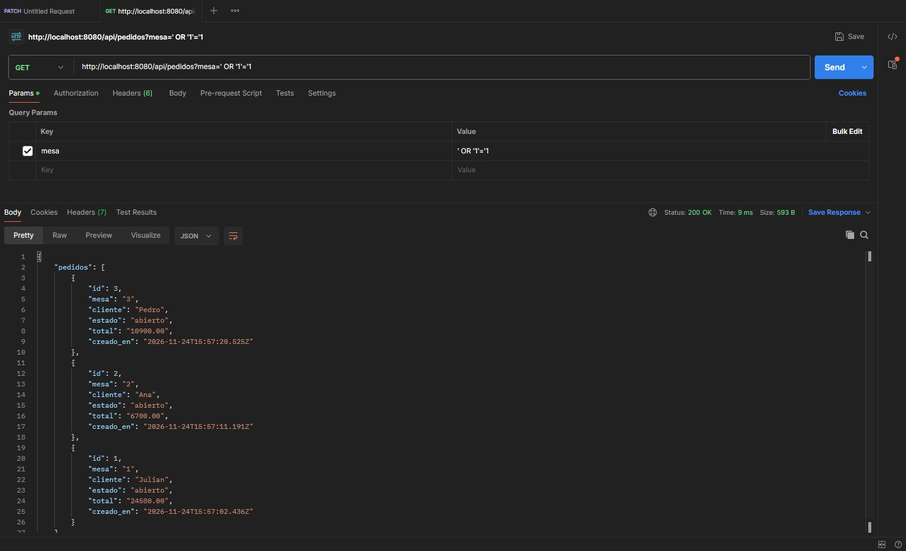
- **Reflexión:** validar formato y tipo de cada parámetro antes de que llegue a la capa de acceso a datos.

---

#### VUL-04

**Inyección SQL en el reporte por origen**

- **Dónde está:** `src/services/reportes.service.ts` (función `ventasPorVariedad`).
- **Por qué ocurre:** además de concatenar la entrada, `UNION SELECT` permite anexar el resultado de **otra tabla**, demostrando que una inyección puede leer toda la base.
- **Cómo se observó:** en el panel, Reportes → "Ventas por origen", enviamos `Brasil' UNION SELECT username, password, 1, 1 FROM usuarios--`. La tabla mostró los usuarios del sistema junto con sus hashes de contraseña.
- **Cómo se corrigió:** se validó el origen contra una lista blanca (`Brasil`, `Colombia`, `Etiopía`) y se parametrizó la consulta con `$1`.
- **Captura:** 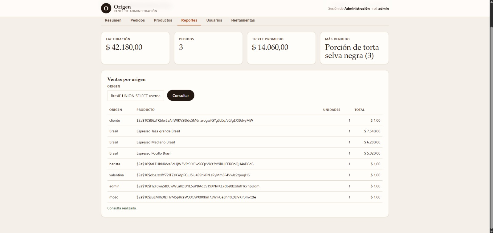
- **Reflexión:** el usuario de la base debería tener permisos mínimos (VUL-26) y las contraseñas estar hasheadas (VUL-13) para limitar el impacto ante cualquier fuga.

---

#### VUL-05

**XSS reflejado en el buscador**

- **Dónde está:** `src/public/js/app.js` (función `renderResultado`).
- **Por qué ocurre:** el texto buscado vuelve desde el servidor y se inserta en el DOM con `innerHTML`, por lo que el navegador lo interpreta y ejecuta como HTML.
- **Cómo se observó:** en el buscador del catálogo escribimos `` y se ejecutó el `alert("1")`.
- **Cómo se corrigió:** se reemplazó `innerHTML` por `document.createElement` y `textContent` para renderizar la búsqueda como texto plano.
- **Captura:** 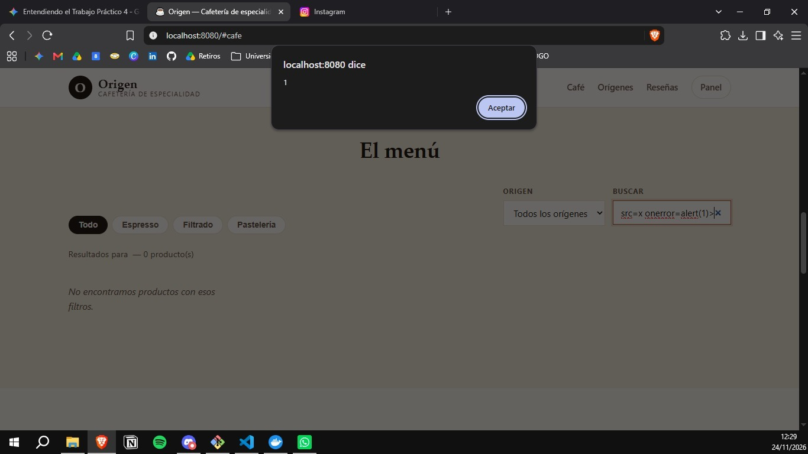
- **Reflexión:** tratar todo dato externo como no confiable y sumar una CSP como segunda barrera (VUL-25).

---

#### VUL-06

**XSS reflejado en los mensajes del servidor**

- **Dónde está:** `src/routes/productos.routes.ts`, `src/routes/auth.routes.ts` y `src/middleware/errores.ts`.
- **Por qué ocurre:** el servidor arma mensajes de error que incluyen literalmente lo que el cliente envió en la URL o en el cuerpo de la petición.
- **Cómo se observó:** al consultar una ruta o parámetro con etiquetas HTML (`/api/productos/<script>alert(1)</script>`), el servidor devolvió el payload reflejado en el JSON de respuesta.
- **Cómo se corrigió:** se validó el ID numérico en `/api/productos/:id` y se reemplazaron las respuestas de error por mensajes genéricos sin reflejar datos de entrada.
- **Captura:** 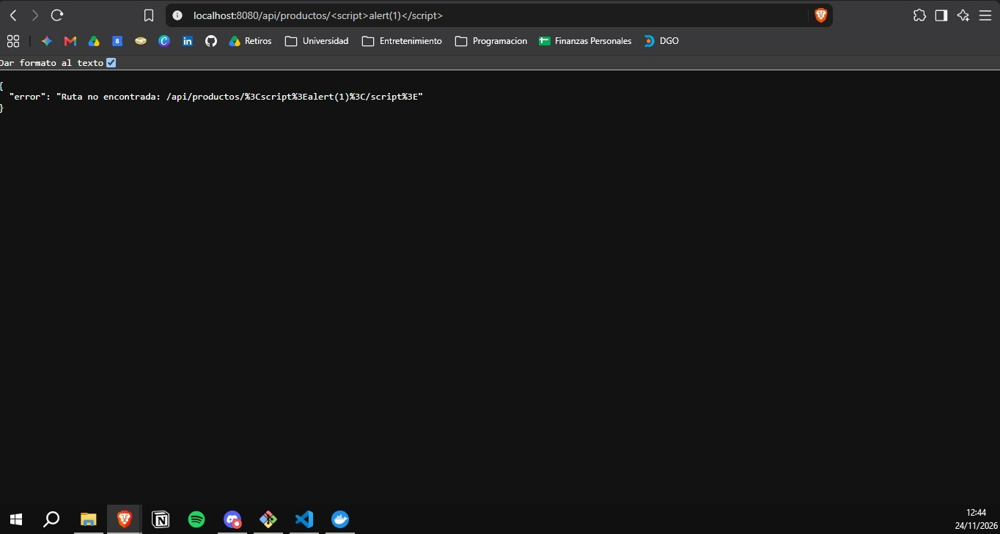
- **Reflexión:** los mensajes de error no deben incluir datos crudos enviados por el usuario.

---

#### VUL-07

**XSS almacenado en las reseñas**

- **Dónde está:** `src/public/js/app.js` (función `cargarReseñas`).
- **Por qué ocurre:** la reseña se guarda sin sanitizar en la base de datos y se inyecta con `innerHTML` cada vez que alguien visita la página, afectando a todos los usuarios.
- **Cómo se observó:** publicamos una reseña con `` y al recargar apareció el `alert("2")` en cada visita.
- **Cómo se corrigió:** se eliminó el uso de `innerHTML` en el renderizado de comentarios, construyendo cada tarjeta con `document.createElement` y `textContent`, y se acotó la longitud en el servidor.
- **Captura:** 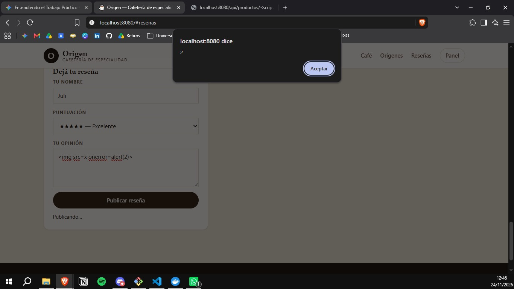
- **Reflexión:** escapar siempre al mostrar datos persistidos en la base, independientemente de su origen.

---

#### VUL-08

**XSS de DOM en el panel**

- **Dónde está:** `src/public/js/admin.js` (función `init`, parámetro `vista`).
- **Por qué ocurre:** el JavaScript del navegador lee el parámetro `vista` de la URL y lo escribe directamente en `#panel-bienvenida` con `innerHTML`, sin intervención del servidor.
- **Cómo se observó:** abrimos `admin.html?vista=` y se ejecutó el `alert("3")` en el navegador del administrador.
- **Cómo se corrigió:** se reemplazó `innerHTML` por `textContent` al actualizar el encabezado del panel.
- **Captura:** 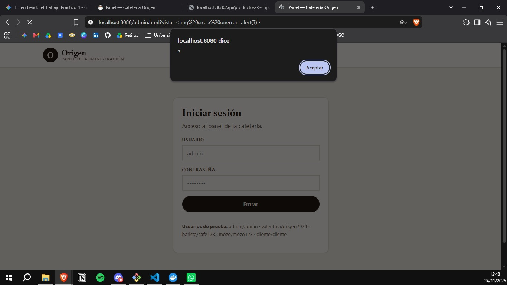
- **Reflexión:** evitar APIs peligrosas del DOM (`innerHTML`) y tratar los parámetros de URL como texto no confiable.

---

#### VUL-09

**CSRF en los formularios que cambian estado**

- **Dónde está:** `src/routes/pedidos.routes.ts`, `src/routes/comentarios.routes.ts` y `src/routes/admin.routes.ts`.
- **Por qué ocurre:** ningún endpoint que modifica estado exigía un token anti-CSRF ni verificaba el origen, y la cookie de sesión se emitía sin `SameSite` (VUL-15).
- **Cómo se observó:** en DevTools → Network se verificó que las peticiones `POST` (como `/api/comentarios` o `/api/pedidos`) se aceptaban con `201 Created` sin ningún token ni cabecera de verificación. Tras la corrección, el servidor emite la cookie `csrf_sid` (`HttpOnly`, `SameSite=Lax`) y exige `X-CSRF-Token`.
- **Cómo se corrigió:** se implementó `src/middleware/csrf.ts` con generación de tokens aleatorios (`GET /api/csrf-token`), verificación de `Origin`/`Referer` y validación de `X-CSRF-Token` en todos los métodos que modifican estado.
- **Captura:** 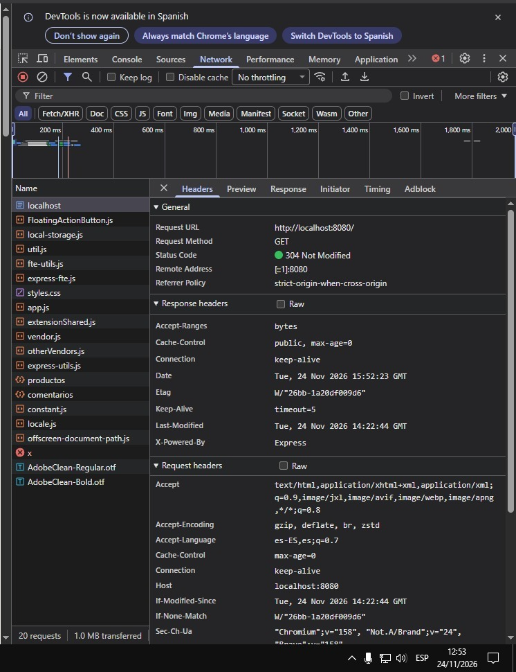
- **Reflexión:** proteger toda operación que modifique estado mediante tokens anti-CSRF por sesión junto con cookies `SameSite`.

---

#### VUL-10

**Validación de entrada ausente en pedidos**

- **Dónde está:** `src/services/pedidos.service.ts` y `src/routes/pedidos.routes.ts`.
- **Por qué ocurre:** el servidor confía en lo que manda el cliente: no valida tipo, rango ni longitud de `cantidad`, `mesa` o `cliente`, y calcula el total con esos valores.
- **Cómo se observó:** enviamos un pedido con `cantidad: -5` para el producto 4. El sistema lo aceptó y el panel mostró una **facturación total negativa** (−$ 28.700,00).
- **Cómo se corrigió:** se incorporó `src/validacion.ts` para exigir cantidades enteras positivas dentro de rango y textos acotados antes de calcular precios o persistir el pedido.
- **Captura:** 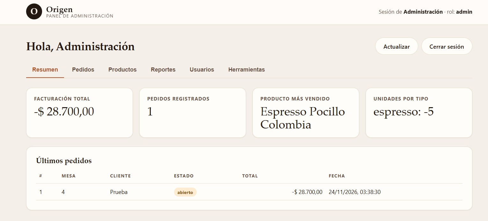
- **Reflexión:** la validación del navegador es solo experiencia de usuario; toda regla de negocio e integridad debe aplicarse en el servidor.

---

#### VUL-11

**Validación de entrada ausente en reseñas**

- **Dónde está:** `src/routes/comentarios.routes.ts`.
- **Por qué ocurre:** no se valida longitud del autor o comentario ni el rango de la calificación (1 a 5).
- **Cómo se observó:** se publicó una reseña con `calificacion: 99`; la aplicación la guardó y dibujó **99 estrellas** en pantalla.
- **Cómo se corrigió:** se aplicó `trim()` y validación estricta de longitud (`autor` entre 2 y 40 caracteres, `texto` entre 3 y 280) y rango entero (`calificacion` entre 1 y 5).
- **Captura:** 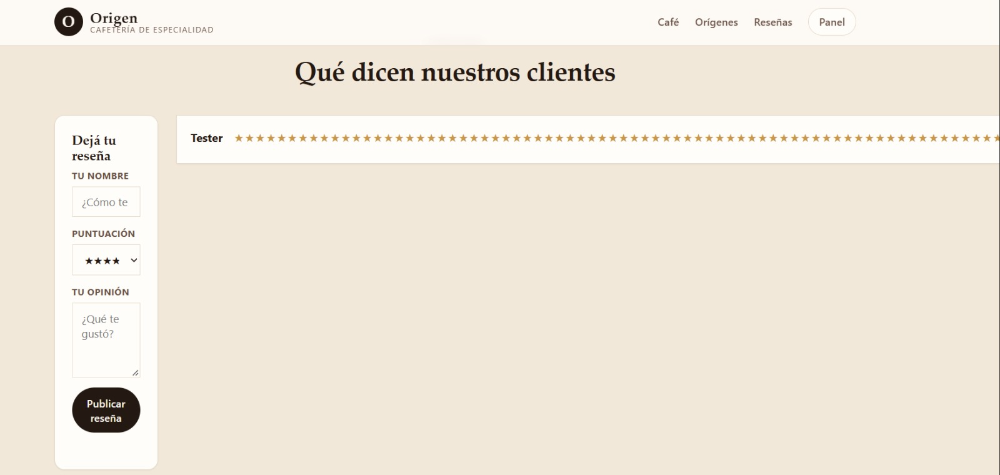
- **Reflexión:** todo campo de texto y valor numérico debe tener límites explícitos en el servidor.

---

#### VUL-12

**Subida de archivos sin restricciones**

- **Dónde está:** `src/routes/admin.routes.ts` (`POST /api/admin/subir-archivo`).
- **Por qué ocurre:** no se validaba extensión, tipo MIME real ni tamaño, y se guardaba con el nombre enviado por el cliente (permitiendo *path traversal* con `../` y ejecución de `.html` desde el mismo origen).
- **Cómo se observó:** en Panel → Productos → "Subir imagen (logo / foto del menú)" subimos `prueba.html`. El servidor lo aceptó y lo publicó directamente en `/uploads/prueba.html`.
- **Cómo se corrigió:** se restringió la carga a una lista blanca de extensiones (`.png`, `.jpg`, `.jpeg`, `.webp`), se verificaron los *magic numbers* del archivo, se limitó el tamaño máximo a 2 MB y se generó un nombre aleatorio con `crypto.randomUUID()`.
- **Captura:** 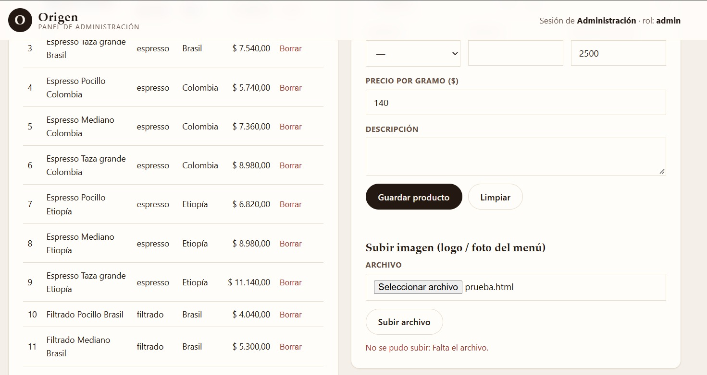
- **Reflexión:** nunca confiar en el nombre ni en la extensión declarada por el cliente al almacenar archivos subidos.

---

#### VUL-13

**Contraseñas en texto plano**

- **Dónde está:** `src/inicializar.ts` y `src/services/usuarios.service.ts`.
- **Por qué ocurre:** las contraseñas se insertaban y comparaban en texto plano; ante cualquier lectura no autorizada de la base (como VUL-04), todas las cuentas quedan expuestas.
- **Cómo se observó:** al inspeccionar la tabla `usuarios` de PostgreSQL, las claves iniciales (`admin`, `origen2024`, etc.) figuraban legibles sin cifrar. Tras aplicar `bcrypt`, pasaron a almacenarse como hashes `$2b$...` (como se ve en la captura de VUL-04).
- **Cómo se corrigió:** se hashearon todas las contraseñas con `bcryptjs` (`bcrypt.hash`) en la carga inicial y en el cambio de clave, comparando en el login con `bcrypt.compare()`.
- **Captura:** 
- **Reflexión:** nunca almacenar contraseñas en texto plano; utilizar algoritmos adaptativos con salt como `bcrypt`.

---

#### VUL-14

**Sin protección contra fuerza bruta**

- **Dónde está:** `src/routes/auth.routes.ts` (`POST /api/auth/login`).
- **Por qué ocurre:** el endpoint de inicio de sesión no tenía límite de intentos fallidos ni bloqueo temporal.
- **Cómo se observó:** probamos múltiples contraseñas erróneas seguidas; en DevTools se acumulan respuestas `401` sin que aparezca ningún bloqueo (`429 Too Many Requests`).
- **Cómo se corrigió:** se configuró `express-rate-limit` sobre `/api/auth/login` limitando los intentos fallidos por ventana de tiempo.
- **Captura:** 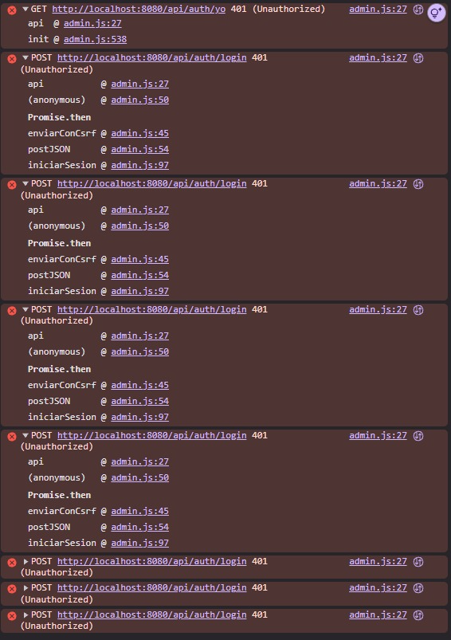
- **Reflexión:** limitar los intentos de autenticación y acompañar con contraseñas robustas.

---

#### VUL-15

**Cookie de sesión sin HttpOnly / Secure / SameSite**

- **Dónde está:** `src/middleware/sesion.ts` (función `crearSesion`).
- **Por qué ocurre:** `res.cookie('sid', id, { path: '/' })` emitía la cookie sin banderas de seguridad, dejándola accesible desde JavaScript (`document.cookie`) y expuesta a envíos cross-site.
- **Cómo se observó:** tras iniciar sesión como `barista`, en DevTools → Application → Cookies la cookie `sid` mostraba vacías las columnas **HttpOnly**, **Secure** y **SameSite**.
- **Cómo se corrigió:** se configuró la cookie con `httpOnly: true`, `sameSite: 'lax'` y `secure: process.env.NODE_ENV === 'production'`.
- **Captura:** 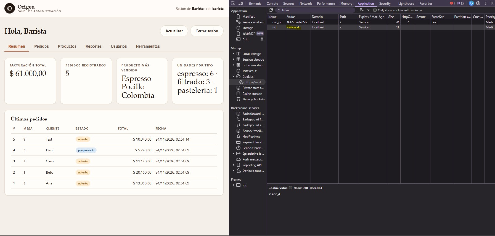
- **Reflexión:** configurar siempre las banderas `HttpOnly`, `SameSite` y `Secure` en las cookies de sesión.

---

#### VUL-16

**Identificador de sesión predecible**

- **Dónde está:** `src/middleware/sesion.ts` (`contadorSesiones`).
- **Por qué ocurre:** el ID de sesión se generaba como `sesion_${contador}`, permitiendo adivinar sesiones activas de otros usuarios o fijar identificadores.
- **Cómo se observó:** al iniciar sesión consecutivamente, la cookie `sid` tomó los valores secuenciales `sesion_1`, `sesion_2` y `sesion_4`.
- **Cómo se corrigió:** se reemplazó el contador incremental por identificadores criptográficamente aleatorios generados con `crypto.randomBytes(32).toString('hex')` y regeneración en cada login.
- **Captura:** 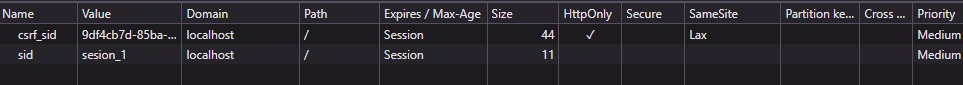 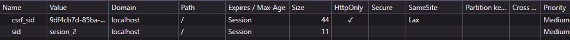
- **Reflexión:** los identificadores de sesión deben tener alta entropía y generarse con primitivas criptográficas seguras.

---

#### VUL-17

**Las sesiones nunca expiran**

- **Dónde está:** `src/middleware/sesion.ts` (`expiraEn: null`).
- **Por qué ocurre:** el servidor no asignaba tiempo de vida ni vencimiento por inactividad a las sesiones creadas.
- **Cómo se observó:** en DevTools → Cookies, la columna `Expires / Max-Age` de `sid` figuraba como `Session` y el servidor nunca invalidaba sesiones antiguas.
- **Cómo se corrigió:** se definieron tiempos de expiración por inactividad y duración máxima absoluta (`Date.now() + TTL`), rechazando y eliminando sesiones vencidas al validarlas.
- **Captura:**  
- **Reflexión:** toda sesión debe tener un TTL acotado tanto por inactividad como de vida total.

---

#### VUL-18

**El logout no invalida la sesión en el servidor**

- **Dónde está:** `src/routes/auth.routes.ts` (`POST /api/auth/logout`).
- **Por qué ocurre:** el cierre de sesión solo enviaba `clearCookie('sid')` al navegador, pero dejaba la sesión activa en el mapa del servidor.
- **Cómo se observó:** tras cerrar sesión, si se reutilizaba el identificador `sid` anterior (`sesion_4`), `/api/auth/yo` seguía respondiendo `200 OK` con los datos del usuario.
- **Cómo se corrigió:** se invocó `destruirSesion(req)` en el handler de `/logout` para eliminar el registro de la sesión del servidor antes de limpiar la cookie.
- **Captura:** 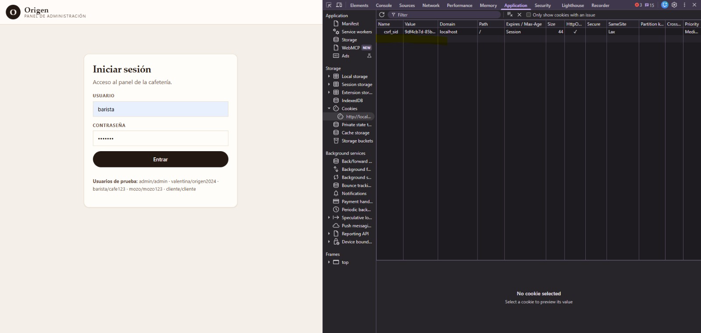
- **Reflexión:** cerrar sesión debe revocar la sesión del lado del servidor, no solo borrarla en el cliente.

---

#### VUL-19

**Enumeración de usuarios**

- **Dónde está:** `src/routes/auth.routes.ts` (`POST /api/auth/login`).
- **Por qué ocurre:** el endpoint devolvía mensajes distintos según si el usuario no existía o si fallaba la contraseña.
- **Cómo se observó:** con el usuario `fantasma` respondió `"El usuario \"fantasma\" no existe en el sistema."`, mientras que con `valentina` y clave incorrecta respondió `"La contraseña es incorrecta."`.
- **Cómo se corrigió:** se unificó la respuesta ante cualquier fallo de credenciales al mensaje genérico `"Usuario o contraseña incorrectos."`.
- **Captura:** 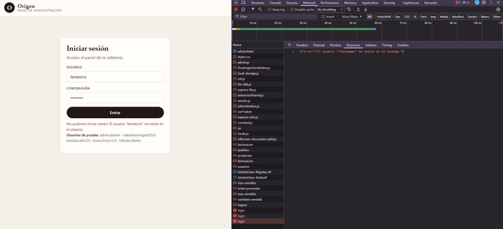 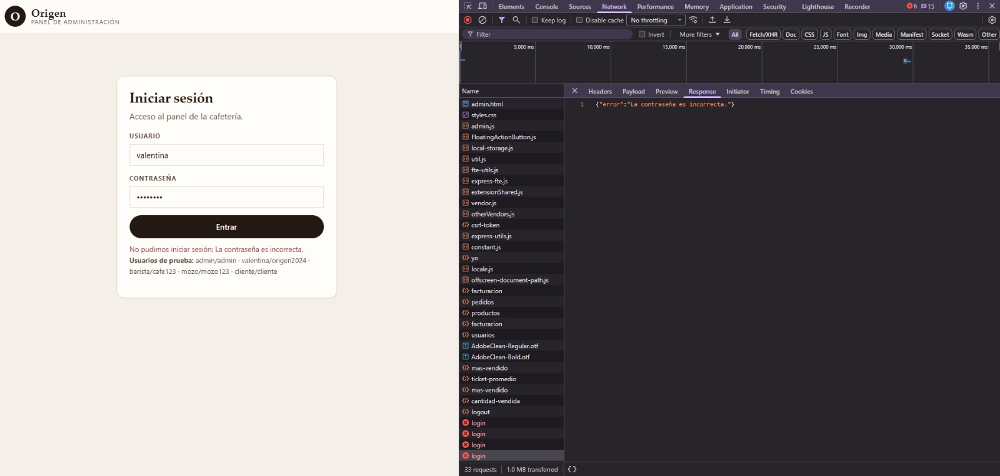
- **Reflexión:** los mensajes de error de autenticación nunca deben revelar qué cuentas existen en el sistema.

---

#### VUL-20

**Autorización ausente: cualquiera entra al panel**

- **Dónde está:** `src/routes/admin.routes.ts`.
- **Por qué ocurre:** se aplicaba `requiereSesion` pero faltaba aplicar `requiereRol('admin')`, permitiendo que cualquier usuario autenticado operara el panel administrativo.
- **Cómo se observó:** iniciamos sesión con el usuario `cliente` y el panel de administración cargó completo con acceso a usuarios, productos y herramientas.
- **Cómo se corrigió:** se agregó `router.use(requiereRol('admin'))` en `admin.routes.ts`.
- **Captura:** 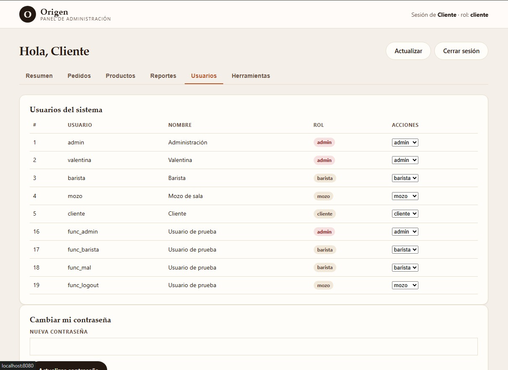
- **Reflexión:** aplicar el principio de denegación por defecto exigiendo autenticación y verificación explícita de roles en cada recurso protegido.

---

#### VUL-21

**Escalada de privilegios**

- **Dónde está:** `src/routes/admin.routes.ts` (`PUT /api/admin/usuarios/:id`).
- **Por qué ocurre:** el campo `rol` recibido en el cuerpo de la petición se asignaba directamente sin validar que el solicitante fuera administrador ni que el rol perteneciera a una lista blanca.
- **Cómo se observó:** estando logueado como `cliente`, la pestaña Usuarios habilitaba el selector de rol sobre cualquier cuenta, permitiendo promoverse a `admin`.
- **Cómo se corrigió:** además de exigir `requiereRol('admin')` a nivel de router, se verificó `req.usuario.rol === 'admin'` y se validó el nuevo rol contra `ROLES_PERMITIDOS`.
- **Captura:** 
- **Reflexión:** evitar la asignación masiva (*mass assignment*) filtrando y autorizando explícitamente los campos sensibles como `rol`.

---

#### VUL-22

**Inyección de comandos del sistema operativo**

- **Dónde está:** `src/routes/admin.routes.ts` (`POST /api/admin/probar-conexion`).
- **Por qué ocurre:** `exec('ping -c 3 ' + host)` ejecutaba `/bin/sh -c` concatenando la entrada del usuario, permitiendo encadenar comandos mediante operadores de shell (`;`, `&&`, `|`).
- **Cómo se observó:** en Panel → Herramientas → "Probar conexión con el proveedor", enviamos `127.0.0.1; cat /etc/hostname` y la salida mostró el ping seguido del ID del contenedor (`055124f10894`).
- **Cómo se corrigió:** se validó `host` contra una lista blanca cerrada (`SERVIDORES_PERMITIDOS`) y se reemplazó `exec` por `spawn('ping', ['-c', '3', host], { shell: false })`.
- **Captura:** 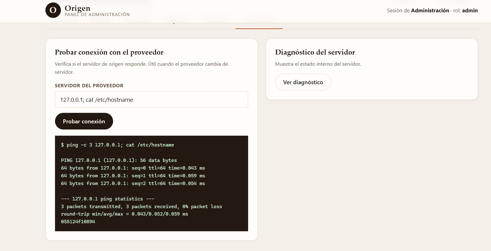
- **Reflexión:** nunca invocar un intérprete de comandos (`sh`/`cmd`) con datos proporcionados por el usuario; usar listas blancas y ejecución directa sin shell.

---

#### VUL-23

**Exposición de secretos por `/api/_diagnostico`**

- **Dónde está:** `src/routes/debug.routes.ts`.
- **Por qué ocurre:** el endpoint de diagnóstico era público y devolvía `process.env` completo junto con `DB_PASSWORD` y `DB_USER`.
- **Cómo se observó:** al abrir `GET /api/_diagnostico` sin autenticación se exponían todas las variables de entorno y credenciales de conexión de la base de datos.
- **Cómo se corrigió:** se protegió la ruta con `requiereSesion` y `requiereRol('admin')`, y se eliminó la exposición de `process.env` y credenciales en la respuesta JSON.
- **Captura:** 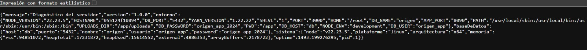
- **Reflexión:** los endpoints de depuración deben restringirse a administradores y jamás exponer variables de entorno ni secretos.

---

#### VUL-24

**Stack traces enviados al cliente**

- **Dónde está:** `src/middleware/errores.ts` (función `manejadorErrores`).
- **Por qué ocurre:** el manejador global de errores devolvía `{ error: err.message, stack: err.stack }` en la respuesta HTTP, revelando rutas internas y detalles de PostgreSQL.
- **Cómo se observó:** al provocar un error de tipo en una consulta, la API devolvió la traza completa con rutas como `/app/src/services/catalogo.service.ts` y `/app/node_modules/pg-pool`.
- **Cómo se corrigió:** se mantuvo el registro del error detallado únicamente en `console.error` del servidor y se devolvió un mensaje genérico (`"Error interno del servidor."`) al cliente.
- **Captura:** 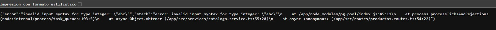
- **Reflexión:** separar los logs internos de depuración de los mensajes públicos enviados al cliente.

---

#### VUL-25

**Sin cabeceras de seguridad**

- **Dónde está:** `src/app.ts` y `Dockerfile`.
- **Por qué ocurre:** la aplicación Express no configuraba `helmet` ni `Content-Security-Policy`, dejando expuesta la cabecera `X-Powered-By` y sin protección contra clickjacking o ejecución de scripts no autorizados.
- **Cómo se observó:** en DevTools → Network se comprobó que las respuestas incluían `X-Powered-By: Express` y carecían de `Content-Security-Policy`, `X-Frame-Options` y `X-Content-Type-Options`.
- **Cómo se corrigió:** se configuró `helmet` con una `Content-Security-Policy` restrictiva (`script-src 'self'`, `object-src 'none'`, `frame-ancestors 'none'`) en `src/app.ts` y se ejecutó el contenedor con usuario sin privilegios (`USER node`) en el `Dockerfile`.
- **Captura:** 
- **Reflexión:** configurar cabeceras de seguridad HTTP y CSP desde la estructura base del proyecto.

---

#### VUL-26

**Base de datos sin contraseña y con superusuario**

- **Dónde está:** `docker-compose.yml`.
- **Por qué ocurre:** `POSTGRES_HOST_AUTH_METHOD: trust` permitía conexiones sin autenticación y la aplicación se conectaba con el superusuario `postgres`.
- **Cómo se observó:** el contenedor de base de datos aceptaba conexiones directas sin contraseña y el servicio `app` operaba con privilegios totales de administrador sobre PostgreSQL.
- **Cómo se corrigió:** se eliminó `POSTGRES_HOST_AUTH_METHOD: trust`, se configuró una contraseña para `postgres` y se conectó la aplicación utilizando el usuario restringido `origen_app` con permisos mínimos (`SELECT`, `INSERT`, `UPDATE`, `DELETE`).
- **Captura:** 
- **Reflexión:** aplicar el principio de mínimo privilegio tanto en los usuarios de base de datos como en los procesos del contenedor.

---

#### VUL-27

**Credenciales por defecto**

- **Dónde está:** `src/config.ts` y `src/inicializar.ts`.
- **Por qué ocurre:** las cuentas iniciales utilizaban contraseñas triviales (`admin`/`admin`, `cliente`/`cliente`, `barista`/`cafe123`, `mozo`/`mozo123`).
- **Cómo se observó:** en la pantalla de inicio de sesión figuraban documentadas las cuentas de prueba con claves predecibles y triviales.
- **Cómo se corrigió:** se reemplazaron las contraseñas triviales de fábrica por claves robustas configurables mediante variables de entorno (`ADMIN_PASSWORD`, `BARISTA_PASSWORD`, `MOZO_PASSWORD`, `CLIENTE_PASSWORD`).
- **Captura:** 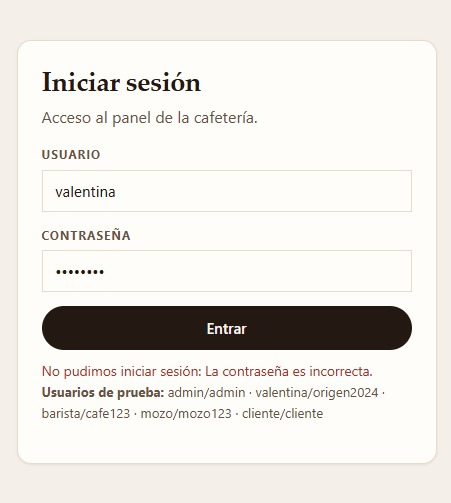
- **Reflexión:** nunca desplegar sistemas con credenciales triviales por defecto; gestionarlas mediante variables de entorno seguras.

---

#### VUL-28

**IDOR: pedidos y datos de otros clientes**

- **Dónde está:** `src/routes/pedidos.routes.ts` (`GET /api/pedidos` y `GET /api/pedidos/:id`).
- **Por qué ocurre:** ambos endpoints devolvían los pedidos y nombres de clientes sin verificar la sesión ni la pertenencia del recurso.
- **Cómo se observó:** al consultar `GET /api/pedidos` en una ventana de incógnito **sin iniciar sesión**, la API listó todos los pedidos de todas las mesas con el nombre de cada cliente.
- **Cómo se corrigió:** se implementó control de acceso por rol y propiedad: el personal autorizado (`admin`, `barista`, `mozo`) accede al listado completo, un usuario `cliente` autenticado solo visualiza sus propios pedidos (recibiendo `403` si consulta un ID ajeno) y los visitantes sin sesión reciben los datos anonimizados sin nombres de clientes.
- **Captura:** 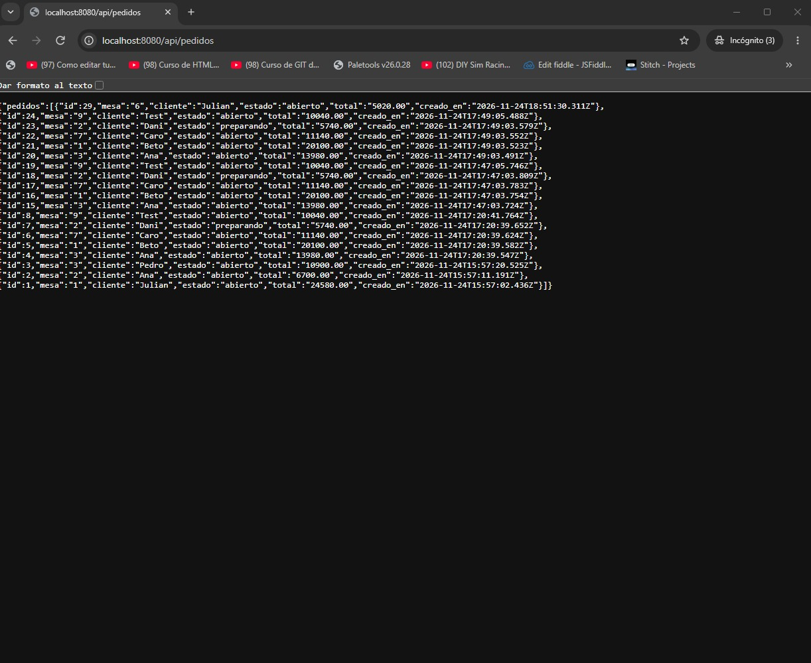
- **Reflexión:** toda lectura de recursos asociados a usuarios debe validar permisos y propiedad en el servidor antes de devolver los datos.

---

## 2. Conclusión

Las fallas encontradas comparten un origen: asumir que "si funciona, está bien". Ninguna rompía el flujo normal de uso; todas surgían al interactuar con la aplicación fuera del camino esperado. La diferencia entre un sistema funcional y uno seguro radica en validar toda entrada en el servidor, aplicar el principio de mínimo privilegio, proteger las sesiones y verificar activamente cada control tanto con pruebas automatizadas (`npm test` 28/28, `npm run test:seguridad` 29/29) como mediante revisión estática (`npm run check:security` 37/37 controles críticos y 4 recomendados cubiertos).
```